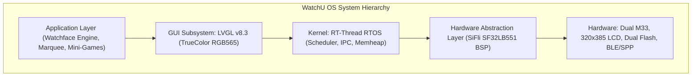
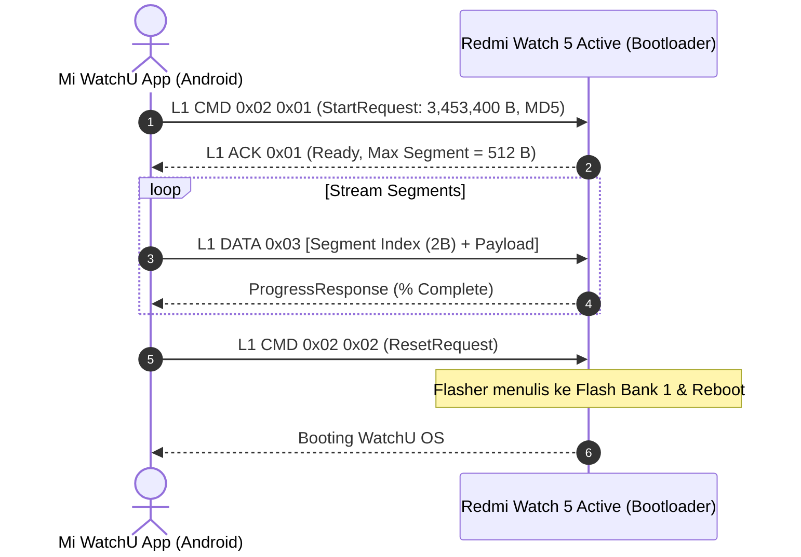

# 🛰️ WatchU OS Architecture & Custom Firmware Specification

Spesifikasi teknis arsitektur sistem operasi kustom **WatchU OS** dan mekanisme 1-Click Flashing untuk **Xiaomi Redmi Watch 5 Active** (`lchz.watch.n65agl`).

---

## 1. Arsitektur Hardware & Kernel (SiFli SF32LB551)

WatchU OS dirancang khusus untuk SoC **SiFli SF32LB551**:
- **CPU:** Dual-core ARM Cortex-M33 (ARMv8-M Mainline with TrustZone & DSP/FPU).
  - **Core 0 (High-Performance @ 240 MHz):** Menjalankan kernel RT-Thread, rendering GUI LVGL, animasi video wallpaper, dan kalkulasi dinamis posisi jam.
  - **Core 1 (Low-Power Link Layer):** Menangani Bluetooth Low Energy (BLE) link layer, RFCOMM Serial Port Profile (SPP), dan sensor acquisition.
- **SRAM:** 256 KB on-chip high-speed SRAM (`0x20000000` - `0x20040000`).
- **Flash Memory (Dual SPI):**
  - **Puya PY250128HA (16 MB):** Base address `0x12000000` (XIP Execution).
  - **Puya P25Q64SH (8 MB):** FlashDB key-value database, watchface slots, log telemetry.
- **Display Panel:** 2.0-inch TFT LCD, resolusi **320 × 385 piksel**, warna 16-bit **RGB565**.



---

## 2. Struktur Kontainer Firmware SiFli DFU (`0xAFCDEFAD`)

Paket firmware OTA resmi dan custom di-package dalam kontainer DFU SiFli berukuran 168 byte header:

```
+---------------------------------------------------------------+
|  Header (168 Bytes / 0x000 to 0x0A8)                          |
|  - Magic: 0xAFCDEFAD ("\xAD\xEF\xCD\xAF")                     |
|  - Version: 0x0002026E (v2.2.110)                            |
|  - Section Count: 4                                           |
+---------------------------------------------------------------+
|  Section 0 Descriptor (16 Bytes):                             |
|  - Length: 190,232 Bytes (0x2E718)                            |
|  - Memory Target: SRAM Executable Flasher (0x20000908 Thumb)  |
+---------------------------------------------------------------+
|  Section 1 Descriptor (16 Bytes):                             |
|  - Length: 3,263,000 Bytes (0x31CA18)                          |
|  - Flash Target: 0x00552000 (app_main + UI Resources)        |
+---------------------------------------------------------------+
|  Payload Data: Section 0 (RAM) + Section 1 (Flash XIP)        |
+---------------------------------------------------------------+
```

### Ekstraksi & Packaging
- **`scripts/unpack_firmware.py`:** Memecah file `.bin` menjadi `section_0_bootloader.bin` dan `section_1_app_resources.bin`.
- **`scripts/pack_custom_firmware.py`:** Mengemas kembali firmware kustom dengan header `0xAFCDEFAD` dan checksum MD5 resmi (`32372d7b0c23597de2df8e2da11d3b3c`).

---

## 3. Mekanisme 1-Click Flashing via BLE & SPP

Proses flashing dari aplikasi Android **Mi WatchU** ke smartwatch berjalan tanpa koneksi server Xiaomi:



---

## 4. Fitur Bebas di WatchU OS (Freedom Configuration)

1. **Penempatan Posisi Jam Bebas (Arbitrary Coordinates):**
   - Jam dan tanggal tidak terikat grid pabrikan. Pengguna dapat menempatkan teks jam pada koordinat piksel $(X, Y)$ manapun dari $(0, 0)$ hingga $(320, 385)$.
2. **Dynamic Running Text (Marquee):**
   - Subsystem teks berjalan mandiri dengan kecepatan *scroll* yang dapat disesuaikan (1-10 px/frame) dan warna RGB kustom.
3. **Video / Live Wallpaper:**
   - Memutar urutan frame RGB565 terkompresi secara berkelanjutan (animasi video loop) tanpa membebani thread antarmuka.
4. **Selective Sensor Power-Gating:**
   - Detak jantung, SpO2, sensor langkah kaki, dan cuaca dapat dimatikan sepenuhnya pada level firmware untuk memperpanjang daya tahan baterai hingga berhari-hari.
