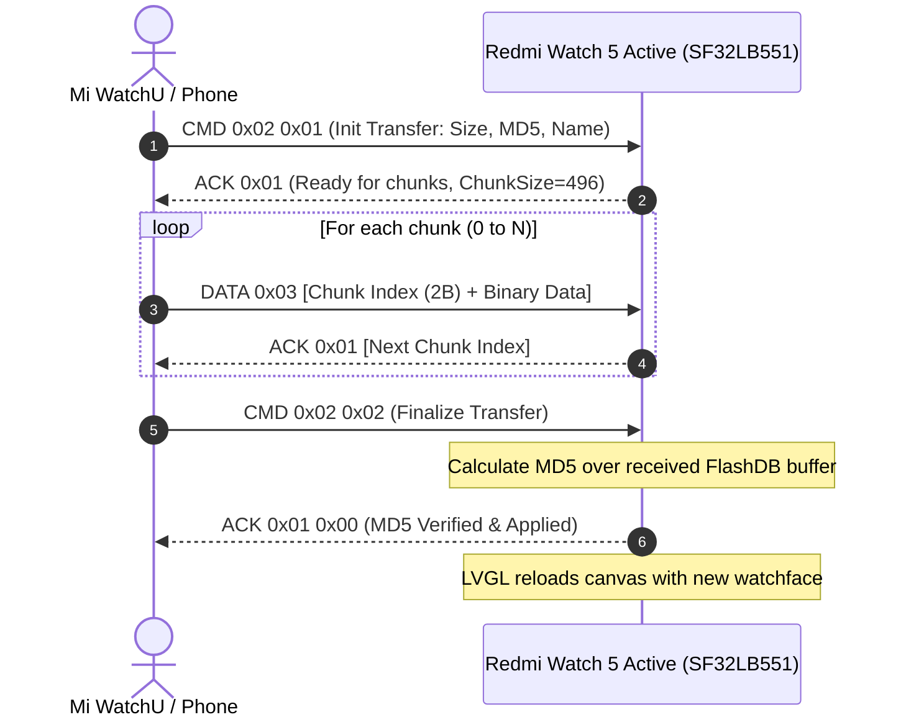

# BLE Communication & L1 Framing Protocol Specification

This document details the Bluetooth Low Energy (BLE) protocol architecture, packet framing, transfer protocols, and notification payloads for the **Redmi Watch 5 Active** (`lchz.watch.n65agl`).

---

## 1. BLE Connection Architecture

The Redmi Watch 5 Active communicates using a custom protocol layered over standard BLE GATT characteristics.

### GATT Services & Characteristics
- **Xiaomi Wearable Service UUID:** `0000FE95-0000-1000-8000-00805F9B34FB` (Xiaomi Inc.)
- **Command Write Characteristic:** Write Without Response / Write Request for outbound packets from phone to watch.
- **Notification Characteristic:** Notify / Indicate for incoming responses, telemetry, heart rate, pedometer, and sensor streams.
- **Negotiated MTU:** Default 23 bytes; negotiated during connection setup up to **247 bytes** or **512 bytes** for high-throughput binary watchface transfers.

---

## 2. L1 Packet Framing

Every packet transmitted across the BLE transport layer is encapsulated in an **L1 Frame**:

```
+---------------+---------------+---------------+---------------+
|          Magic (2B)           |   Type (1B)   |   Seq (1B)    |
|             0xA5A5            |               |               |
+---------------+---------------+---------------+---------------+
|       Payload Length (2B)     |       Payload Data (N Bytes)  |
|          (Little Endian)      |              ...              |
+---------------+---------------+---------------+---------------+
|       CRC16-CCITT (2B)        |
|    Poly: 0x1021, Init: 0xFFFF |
+---------------+---------------+
```

### Field Breakdown:
| Field | Size | Description |
|---|---|---|
| **Magic** | 2 Bytes | Fixed signature `0xA5A5` (`\xA5\xA5`) identifying frame start. |
| **Type** | 1 Byte | `0x00`: NAK / Error<br>`0x01`: ACK / Response<br>`0x02`: Command Request<br>`0x03`: Stream / Data Chunk |
| **Sequence** | 1 Byte | Rolling 8-bit counter (`0x00` - `0xFF`) for packet reordering and deduplication. |
| **Payload Length** | 2 Bytes | Size of the payload in bytes (uint16 little-endian). Maximum size depends on negotiated MTU. |
| **Payload** | N Bytes | Encrypted or plain payload containing the L2 subcommands. |
| **CRC16-CCITT** | 2 Bytes | Computed over `[Type + Seq + Length + Payload]` using polynomial `0x1021` and initial seed `0xFFFF`. |

---

## 3. Watchface OTA Transfer Protocol

Unlike firmware upgrades, watchfaces are transmitted without RSA signatures. The watch verifies only the MD5 hash provided in the transfer initialization header.



### Handshake & Header Payload (`CMD 0x02 0x01`):
1. **Command Byte:** `0x02`
2. **Subcommand:** `0x01` (Prepare Watchface Install)
3. **Total File Size:** 4 Bytes (uint32 little-endian)
4. **MD5 Checksum:** 16 Bytes raw binary MD5 digest
5. **Watchface Identifier:** 16-32 Bytes ASCII string identifier

---

## 4. Notifications & Running Text Marquee Payload

Notifications and live running text are sent via L1 Command packets (`Type 0x02`, Subsystem `0x04` Notification Management):

```
+------------+------------+------------+------------+
| Subsys 0x04| Opcode 0x01| AppID (1B) | Flags (1B) |
+------------+------------+------------+------------+
| Title Len  | Title String (UTF-8, e.g. "WhatsApp")|
+------------+------------+------------+------------+
| Body Len   | Message / Running Text (UTF-8)       |
+------------+------------+------------+------------+
```

### Field Definitions:
- **AppID:**
  - `0x01`: Incoming Phone Call
  - `0x02`: SMS
  - `0x03`: WhatsApp (`com.whatsapp`)
  - `0x04`: Telegram (`org.telegram.messenger`)
  - `0x05`: Custom Running Text Marquee / System Broadcast
- **Flags:**
  - Bit 0: Vibrate motor on receive (`0x01`)
  - Bit 1: Wake display on receive (`0x02`)
  - Bit 2: Persistent notification (keep on screen) (`0x04`)
  - Bit 3: High priority interrupt (`0x08`)
- **Marquee Formatting:** Custom text strings sent with AppID `0x05` trigger the watch's LVGL scrolling text label, rendering up to 256 characters dynamically on the display.
